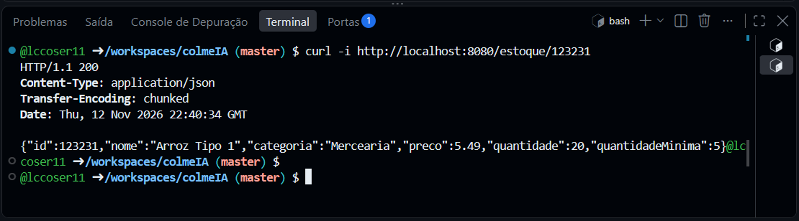
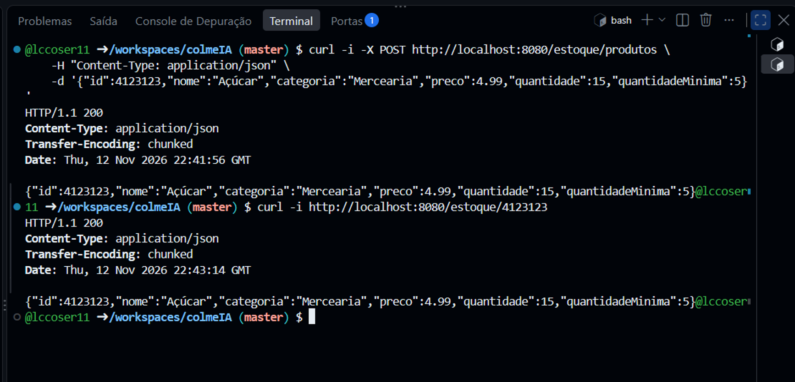

# Registro dos Testes Funcionais: colmeIA

**Disciplina:** Programação para Internet
**Aplicação:** colmeIA (API REST de Controle de Estoque)
**Ambiente:** GitHub Codespace, porta 8080
**Data:** 12/11/2026

---

## Teste 01: Funcionalidade: Consultar produto por id

- **Entrada/ação:** Requisição `GET http://localhost:8080/estoque/123231`

  ```bash
  curl -i http://localhost:8080/estoque/123231
  ```

- **Resultado esperado:** Status `200 OK` e JSON com os dados do produto de id 123231:

  ```json
  {"id":123231,"nome":"Arroz Tipo 1","categoria":"Mercearia","preco":5.49,"quantidade":20,"quantidadeMinima":5}
  ```

- **Resultado obtido:** 

- **Situação:** Passou


---

## Teste 02: Funcionalidade: Cadastrar produto

- **Entrada/ação:** Requisição `POST http://localhost:8080/estoque/produtos` com corpo JSON, seguida de uma consulta para conferir o cadastro:

  ```bash
  curl -i -X POST http://localhost:8080/estoque/produtos \
    -H "Content-Type: application/json" \
    -d '{"id":4123123,"nome":"Açúcar","categoria":"Mercearia","preco":4.99,"quantidade":15,"quantidadeMinima":5}'

  curl -i http://localhost:8080/estoque/4123123
  ```

- **Resultado esperado:** Status `200 OK` e JSON do produto cadastrado (Açúcar, id 4123123). A consulta por id seguinte também retorna `200 OK` com o mesmo produto.

- **Resultado obtido:** 

- **Situação:** Passou

---

## Evidências


